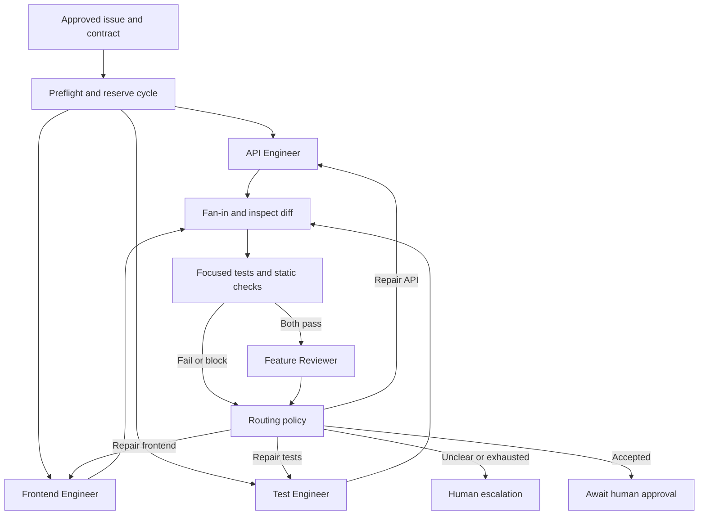

# Feature delivery graph

## Node contracts

| Node | Inputs | Output | Write scope |
|---|---|---|---|
| Preflight | Issue, shared contract, repo and prerequisites | Approved scope, baseline evidence, cycle ledger | `.demo-state/run.md` only |
| API | Issue + contract + findings | Implementation handoff | `api/` |
| Frontend | Issue + contract + findings | Implementation handoff | `client/src/` |
| Test | Issue + contract + findings | Test handoff | `client/test/`, new `verification/browser/tests/` files |
| Integration | All worker results | Checked file ownership, actual diff | None (send corrections to owner) |
| Checks | Integrated diff + running servers | Tests/static evidence | None |
| Reviewer | Same diff + gate evidence | Review findings or accepted | None |
| Routing | Validated evidence and cycle count | Deterministic next action | `.demo-state/run.md` and evidence JSON only |

## Preflight and check gates

Follow README setup first. If `.demo-state/run.md` already exists, load it and resume its current node only after checking the diff and obtaining the required decision/authorization. Never rerun baseline-only expectations against a partially implemented feature or reset the ledger. The baseline checks below apply only to a genuinely fresh run. Check `git status --short`, `dotnet --version`, `node --version`, `npm --prefix client ci` and browser tooling setup if not already completed by the engineer. Dependency installation is a preflight/setup action only, not permission to change manifests. Start API/Vite in separate engineer-controlled terminals as documented. Confirm both endpoints reachable. Verify baseline via `npm --prefix client test`, `dotnet build`, `npm --prefix client run build`; browser acceptance tests are intentionally red before pagination, not a baseline gate. If preflight fails, do not edit to fix unrelated issues.

On every integrated cycle, after all workers return, ensure the API process is restarted on the current source (ask engineer to restart if necessary, or use documented `dotnet watch` with verified reload). No check while workers are editing. Run both gates even if one fails, when safe:

1. Focused tests: `npm --prefix client test`, `dotnet run --project verification/api/CustomerDirectory.QueryChecks.csproj`, and `npm --prefix verification/browser test` (against current API and Vite). All three must pass. If a test cannot run, gate is blocked.
2. Static checks: `dotnet build` and `npm --prefix client run build`. Both must pass (the latter type-checks before building).

The original seed has unique names. The supplied dependency-free query check tests a synthetic tied-name fixture using the shared sort seam; do not change production seed data to create ties. UI keyboard tests are not an exhaustive accessibility audit. If a required acceptance criterion remains unverified, block rather than waive it.

## State and budget

Use `.demo-state/run.md` with issue, approved contract, starting Git status, cycle limit (3), cycles used, ordered transitions, outstanding worker calls, changed paths, command evidence, findings/owners and next route. Preserve it across sessions. No independent worker retries. First authorized edit wave consumes 1 even if blocked; each subsequent correction wave consumes 1. Multiple owners in one wave share a cycle. Read-only preflight, review and a no-edit rerun of a known transient tooling failure consume no extra cycle. No further wave after 3 without explicit approval. If the diff changes after checks/review, invalidate evidence and recheck.

## Routing policy

Before calling the script, classify each finding from actual evidence. `repairable` only for a specific in-scope defect supported by evidence. A test failure is not automatically a test defect. A missing requirement, conflict, unavailable prerequisite, ambiguous ownership, unrelated failure or out-of-scope change is a human blocker. `node demo/graph/route.mjs .demo-state/evidence.json` calculates route from the evidence record; see `handoff-contract.md`. The coordinator writes the evidence file and records the output. The script is deterministic, but the agent must invoke it and classify evidence honestly. It does not enforce tool use or manage subagents. If a worker blocks, stop further edit waves and escalate after outstanding work returns.
